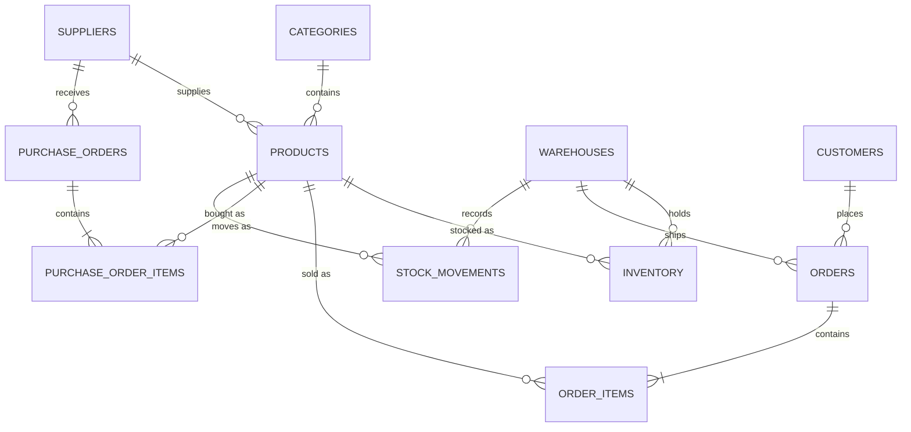

# E-Commerce Inventory Database

A MySQL database for a small online retailer that sells from three warehouses. It tracks the product catalogue, suppliers, stock per warehouse, customer orders and purchase orders, and records every stock movement. On top of that it provides **12 reporting queries** that answer the questions an operations or finance team actually asks:

- Is revenue growing, and what is our margin?
- What should we reorder today, and how many days of stock are left?
- Which products earn most of our revenue (ABC analysis)?
- What stock is sitting on the shelf and not selling?
- Which customers are our best, and which are drifting away?
- Which suppliers deliver late?

The sample data covers **nine months of trading** (January to September 2026): 898 orders, about 1,500 order lines, 275 purchase orders and 1,800+ stock movements.

**Tech:** MySQL 8 · SQL (DDL, DML, views, stored procedures, transactions, CTEs, window functions) · Python (sample data generator)

---

## Database design



| Table | Purpose |
|---|---|
| `categories`, `suppliers`, `products` | The catalogue. Each product has a cost, a selling price and a reorder level. |
| `warehouses`, `inventory` | How many units of each product are in each warehouse right now. |
| `customers`, `orders`, `order_items` | Sales. The item price is stored on the order line, so later price changes do not rewrite history. |
| `purchase_orders`, `purchase_order_items` | Restocking from suppliers, with order and delivery dates. |
| `stock_movements` | An audit trail of every stock change: sales, purchases, returns and adjustments. |

Design decisions:

- **Constraints enforce the rules.** `CHECK` constraints stop negative stock, zero-quantity order lines, selling below cost and deliveries dated before the order.
- **The audit trail explains the stock.** Every change to `inventory` has a matching row in `stock_movements`, so stock on hand can always be reconciled (report 12 proves it).
- **Prices are captured at the time of sale** in `order_items.unit_price`, so revenue reports stay correct when the catalogue price changes.
- **Indexes match the queries**: on order date and status, product, category, supplier and status.

## What's in the repo

```
sql/
  01_schema.sql        Tables, keys, constraints and indexes
  02_seed_data.sql     Sample data (generated, see below)
  03_views.sql         Reusable views: sales lines with margin, stock per product, order totals
  04_procedures.sql    Stored procedures for placing an order and receiving a purchase order
  05_reports.sql       12 reporting queries
scripts/
  generate_seed_data.py  Simulates nine months of trading to produce 02_seed_data.sql
```

## How to run it

You need MySQL 8.0.16 or later (CHECK constraints are enforced from 8.0.16).

**MySQL Workbench:** open each file in `sql/` in order (`01` to `05`) and run it. For `05_reports.sql`, run one query at a time.

**Command line:**

```bash
mysql -u root -p < sql/01_schema.sql
mysql -u root -p < sql/02_seed_data.sql
mysql -u root -p < sql/03_views.sql
mysql -u root -p < sql/04_procedures.sql
mysql -u root -p ecommerce_inventory
```

Then paste a query from `sql/05_reports.sql`.

**Regenerating the sample data** (optional, Python 3.9+ with no extra packages):

```bash
python scripts/generate_seed_data.py
```

## The reports

| # | Question | Techniques |
|---|---|---|
| 1 | How is revenue trending month to month? | CTE, `LAG`, running total with `SUM() OVER` |
| 2 | Top three products in each category | `RANK() OVER (PARTITION BY …)`, share of category |
| 3 | What needs reordering, and how many days of stock are left? | Multiple CTEs, open purchase orders, days-of-cover calculation |
| 4 | What is the stock in each warehouse worth? | Conditional aggregation |
| 5 | ABC analysis: which products earn most of the revenue? | Cumulative share with a framed window |
| 6 | Dead stock: what is in stock but not selling? | `LEFT JOIN` to the last sale, date arithmetic |
| 7 | Customer segmentation (RFM) | `NTILE(4)` scoring on recency, frequency and spend |
| 8 | Are suppliers delivering on time? | Promised vs actual lead time, late percentage |
| 9 | Which categories make the money, not just the revenue? | Gross margin, `SUM(SUM()) OVER ()` |
| 10 | Which products are bought together? | Self-join on order lines |
| 11 | Cancellation and return rates by month | Conditional aggregation |
| 12 | Does stock on hand match every recorded movement? | Reconciliation (should return no rows) |

### Sample results

**Supplier performance (report 8):** one supplier is late more than half the time.

| supplier | promised_days | deliveries | avg_actual_days | late_deliveries | late_pct |
|---|---|---|---|---|---|
| ActiveLife Imports | 14 | 33 | 16.4 | 19 | 57.6 |
| HomeWorks Wholesale | 10 | 29 | 11.3 | 9 | 31.0 |
| Mzansi Pantry Co. | 3 | 59 | 3.4 | 14 | 23.7 |
| GlowCare Supplies | 5 | 54 | 5.2 | 9 | 16.7 |
| TechSource Distributors | 7 | 54 | 7.2 | 6 | 11.1 |
| PaperTrail Office | 6 | 30 | 6.1 | 1 | 3.3 |

**Dead stock (report 6):** stock that has not sold in more than 60 days.

| sku | name | total_on_hand | stock_value_at_cost | last_sold | days_since_last_sale |
|---|---|---|---|---|---|
| OS-5005 | Whiteboard 90x60cm | 6 | 1380.00 | 2026-04-26 | 157 |
| HK-2005 | Hand Blender 600W | 5 | 1300.00 | 2026-01-04 | 269 |
| SO-4005 | Camping Chair | 6 | 1260.00 | *never sold* | |

**Monthly trend (report 1, first four months):**

| month | orders | revenue | avg_order_value | gross_margin_pct | revenue_ytd | mom_growth_pct |
|---|---|---|---|---|---|---|
| 2026-01 | 95 | 59415.00 | 625.42 | 50.8 | 59415.00 | |
| 2026-02 | 88 | 48150.00 | 547.16 | 51.2 | 107565.00 | -19.0 |
| 2026-03 | 98 | 63041.00 | 643.28 | 49.9 | 170606.00 | 30.9 |
| 2026-04 | 90 | 56489.00 | 627.66 | 50.1 | 227095.00 | -10.4 |

## Stored procedures

`sp_place_order` and `sp_receive_purchase_order` are the two operations that change stock. Each one runs in a transaction and locks the inventory or purchase-order row it changes with `SELECT … FOR UPDATE`, so two customers cannot both buy the last unit. If anything fails, the whole operation is rolled back and the error is raised with a clear message.

```sql
CALL sp_place_order(5, 1, 12, 2, @order_id);   -- customer 5, JHB warehouse, product 12, qty 2
SELECT @order_id;

CALL sp_receive_purchase_order(270);            -- adds every line of PO 270 to stock
```

## How the sample data is made

Random rows would make the reports meaningless, so `generate_seed_data.py` simulates the business day by day:

- Orders arrive every day, with more at weekends and at month end (payday). Each product sells in proportion to its demand.
- A sale can only take stock that is actually on the shelf in that warehouse.
- When stock falls below the reorder level (expected sales during the supplier's lead time plus a week of safety stock), a purchase order is raised. It arrives after the supplier's lead time, and less reliable suppliers are often late.
- Some orders are cancelled or returned. A few products stop selling partway through the year, which is what report 6 picks up.

Because every change is written to `stock_movements`, the final `inventory` table always equals the sum of the movements.

## Ideas for next steps

- Triggers or scheduled events to raise purchase orders automatically.
- A `price_history` table for tracking price changes over time.
- A small dashboard (Power BI or Python) on top of the views.
